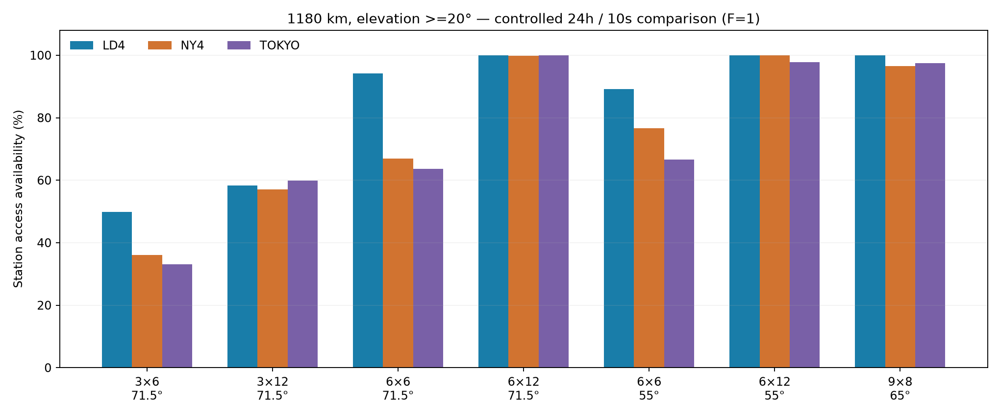

# 轨道面、面内卫星、倾角与相位：覆盖比较

2026-10-12。比较目标是 LD4、NY4、东京代理三站的几何接入，不是整个北半球，也不是星间网络 SLA。高度统一1180km，最低仰角20°，RAAN按Walker-Delta均布360°，使用同一历元、WGS84站点与Kepler/长期J2模型。

## 结论

四个变量要联合优化：面数P补轨道面之间的缺口；每面星数S补同轨前后星之间的时间缺口；倾角i决定卫星纬度分布；Walker相位F决定不同面的到达窗口是否互补。它们不能互相无限替代。

当前18星配置未覆盖全天，不能据此断言所有18星轨道族全局无解。本轮更大的圆轨道候选已显示改善；仍未确定最少星数。

## 控制变量结果

下面除最后一行以外均使用F=1；最后一行同时优化了倾角与相位，不能把改善全部归因于倾角。

| 总星数 | 布局 | 倾角 | F | 三站同时至少1星 | 三站同时至少2星 |
|---:|---|---:|---:|---:|---:|
| 18 | 3×6 | 71.5° | 1 | 4.35% | 0.00% |
| 36 | 3×12 | 71.5° | 1 | 18.89% | 0.22% |
| 36 | 6×6 | 71.5° | 1 | 31.78% | 0.00% |
| 36 | 6×6 | 55° | 1 | 60.47% | 26.57% |
| 72 | 6×12 | 71.5° | 1 | 99.78% | 29.80% |
| 72 | 9×8 | 55° | 1 | 100.00% | 86.49% |
| 72 | 6×12 | 50° | 5 | 100.00% | 95.27% |

前六行是24h/10s快照统计。最后一行已用24h/1s复核，数值取该复核；还以7d/10s重放，单星覆盖仍为100%，三站双星同时覆盖约95.01%。有限采样100%不是连续时间或永久运行证明。

本轮147组倾角/相位粗扫覆盖6×6、6×12、9×8；倾角45/50/55/60/65/71.5/75°，F取0到P−1。36星排名最高的6×6、50°、F=5在24h/1s复核中，三站同时有星约90.38%，最长共同接入缺口169s，仍不满足连续服务。72星候选只是在这一有限搜索中的高覆盖候选，不是全局最优或最少星数解。

## 为什么加面和加星解决不同问题

1180km、20°仰角的球面足印半角约17.53°。卫星只会沿所在轨道面运行。

如果地面站离所有轨道面的最近角距都大于可见足印，即使每条轨道填满无限卫星也接不到。因此，同一3面/71.5°构型里继续加星能减少经过时的间断，却不能消除由轨道面位置造成的长缺口。

增加轨道面使更多不同经度/方向的轨道进入可接入带，适合补面间缺口。但同面星数太少也会留下很长时间间隔：固定总18星改成6×3、71.5°、F=1，虽然轨道面连续环的必要接入条件改善，本次快照中三站同时有星反而为0%。不能据此说所有6×3相位都为0%，更不能把“面越多”当作不增总星数的通用解。

面内加星还改善骨干几何：S=6时相邻中心角60°、距离约7558km；S=12时中心角30°、距离约3912km，更容易落入现有6000km ISL距离假设。固定18星的6×3每面间隔120°，1180km下的同面邻接弦穿入地球，不能直接保留前后环形激光骨干。

## 倾角如何选择

三个目标站纬度约35–52°。71.5°使纬度驻留分布偏向更高纬，未必最有利于这些机房；把倾角降到50–60°值得联合搜索。本轮36星在同面数和F=1下，55°倾角的三站共同接入明显优于71.5°。

倾角不需要与伦敦—东京大圆航线的顶点纬度相等。接入覆盖优化与最短星间路径优化是不同目标：低倾角可能改善机房接入，同时使高纬空间捷径变差。下一轮需将真实ISL路径长度、PAT、终端分配和双向RTT加进目标，而不是只最大化地面足印。

标准Walker变量含总星数、面数、倾角和面间相位；参见 [STK Walker定义](https://help.agi.com/stk/Content/stk/tools-12.htm) 与 [STK星座覆盖设计流程](https://help.agi.com/stk/Content/training/SatConstDesignwithAnalyzer.htm)。本报告数值来自本项目，未用公开星座结果代替本地计算。

## 下一阶段的验收目标

建议以 **6×12、50°、F=5** 为接入覆盖候选起点，同时保留9×8、55°、F=1等不同布局。进一步扫48/54/60/72/96星与非均匀轨道面，寻找预算—覆盖—时延前沿，不直接宣称72是最少数量。

先求解连续接入与切星重叠窗口，再检查备用路径完成捕获所需时间。全天每秒都有两颗星是较强的冗余目标，并非无损切星的唯一必要形式；关键是每次切换前有足够的端到端重叠建链窗口。当前95.27%双星覆盖不能自动证明或否定所有切星是否可无损，需要逐事件分析。

之后验证星间连通、有限激光头、最大距离、云台/FOV/捕获、排队和故障；再评估伦敦—东京RTT与抖动。站点单星接入100%不能替代这几层。

手机预览已部署七个对比选项，按需下载所选星历，并保持切换时的时间和视角。[打开对比预览](https://walker-delta-coverage-guoya.polyguoyang.chatgpt.site)。站点已公开发布。每个方案的几何统计口径显示在页面内。部署记录在 `outputs/design-comparison/deployment.json`。

本报告是已完成研究的归档，摘要与图表保存在 `examples/research/design-comparison/`。当前可复用入口见 [工具说明](tool-guide.md)，不自动重跑本报告的参数扫描。
