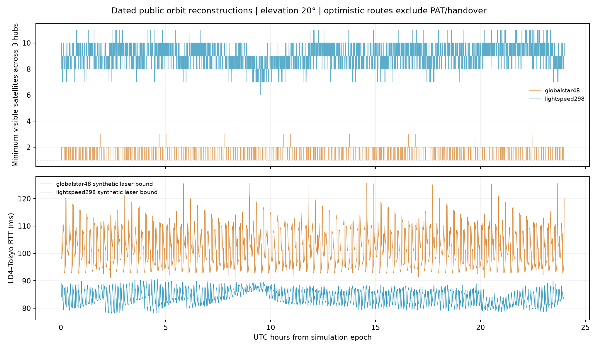

# Globalstar 与 Lightspeed 公开设计复现

2026-10-12。三站为 LD4/Slough、NY4/Secaucus 与东京城市代理。本站点坐标沿用前次研究。结果是同一历元下的理想轨道重建与合成网络敏感性实验，不是运营商实测或实时在轨星历。

## 复现参数和出处

| 方案 | 轨道层 | 高度 | 倾角 | 布局 |
|---|---|---:|---:|---|
| Globalstar 历史48星 | 单层 Walker-Delta | 1414 km | 52° | 8面×6星，F=1 |
| Lightspeed 2020申报298星 | 极轨层 | 1015 km | 98.98° | 6面×13星＝78星 |
| 同上 | 倾斜层 | 1325 km | 50.88° | 20面×11星＝220星 |

Globalstar高度/倾角及历史规模见 [FCC历史申报](https://docs.fcc.gov/public/attachments/DOC-224926A1.pdf)，48/8/1相位布局见 [AIAA原始覆盖研究](https://doi.org/10.2514/1.A33826)。[运营商官网](https://www.globalstar.com/en-us/about/who)目前列出较少卫星的配置及地面bent-pipe转发架构。因此本次48星指历史理想布局，其激光时延结果均是反事实。

Lightspeed采用 [2020年运营商申报表](https://fcc.report/IBFS/SATMPL-20200526-00053/2378318.pdf)中的Modified Constellation，完整面数、每面星数可据此复现。后来的198星与2026年的225星融资计划是不同版本，不混入本次298星模型。申报缓存明确给出高度、倾角及数量；以下布局细节仍作假设：极轨层按Walker-Star均布RAAN 0/30/60/90/120/150°，倾斜层按Walker-Delta均布0/18/.../342°；两层F=1、RAAN原点0、初始平近点角原点0。并未取得运营商完整接触计划或真实面间相位。

传播使用圆轨道Kepler＋长期J2，每个轨道层保持自己的半径、倾角、节点进动率；ECEF只计一次地球自转。最低服务仰角由WGS84椭球法向判定。

## 接入覆盖

下表以24小时每1秒采样统计；单星列指三个站点同时各有至少1星，双星列指同时各有至少2星。

| 方案 | 最低仰角 | 三站单星接入 | 三站双星接入 | 24h采样最长接入缺口 |
|---|---:|---:|---:|---:|
| 原18星3×6、71.5°、1180km，F=1 | 20° | 4.35%（10s采样） | 0% | 6.23小时（10s采样） |
| 前次72星6×12、50°、1180km，F=5 | 20° | 100% | 95.27% | 0s |
| Globalstar历史48星 | 20° | **100%** | **62.56%** | **0s** |
| Globalstar历史48星 | 10° | **100%** | **99.58%** | **0s** |
| Lightspeed 2020双层298星 | 20° | **100%** | **100%** | **0s** |

两个公开设计在7天、10秒采样复核中，三站单星接入仍为100%；Globalstar的共同双星接入62.27%，Lightspeed为100%。24小时1秒检查中，Lightspeed三站最少可见星数分别为LD4 6、NY4 8、东京7。另选六组Lightspeed两层相位/相对初相位做24h/30s敏感性检查，均保持共同单星与双星接入100%。这些有限采样结果不构成连续时间或永久运行证明。

Globalstar48星的接入结果比前次72星并不矛盾：高度增加234km、面数增到8且相位布局不同。20°仰角下球面足印半角从1180km的17.53°增至1414km的19.72°。这说明72星不是最少星数结论。降低仰角也显著增加重叠，但链路预算、遮挡与地面终端要求应另行验证。

## 合成激光路径与时延

这是瞬时图的乐观计算：星间线段不得进入地球赤道半径＋80km大气边界，最大激光距离6000km；卫星处理5μs/星，星地调制解调0.5ms/腿/方向，真空光速。RTT为同一快照对称OWTT的两倍。按24h/30s求三条跨洲路径；可见星地链路即时接入，不受两天线或捕获时间限制。

“自由选边”允许所有满足几何和距离条件的星间边，忽略有限激光头、PAT及协议捕获，因此是该假设下的时延乐观边界。“固定四邻居”每层只保留同面前后和相邻面同编号边，禁跨层；这是合成敏感性拓扑，并非运营商激光设计。极轨层的首尾面接缝保持开口。Globalstar本身没有这套激光骨干，以下全部Globalstar RTT都不是其真实服务性能。

| 模型 | 路由假设 | 航线 | 接通率 | 平均RTT | 在线P99 RTT | 在线P99−P1 |
|---|---|---|---:|---:|---:|---:|
| Globalstar48虚拟激光 | 自由选边 | 伦敦—纽约 | 100% | 60.56ms | 80.47ms | 29.29ms |
| 同上 | 自由选边 | 伦敦—东京 | **100%** | **102.09ms** | **119.26ms** | **26.45ms** |
| 同上 | 自由选边 | 纽约—东京 | 100% | 107.51ms | 117.76ms | 19.65ms |
| 同上 | 固定四邻居 | 伦敦—东京 | **86.81%** | 120.23ms | 169.66ms | 76.81ms |
| Lightspeed298重建 | 自由选边、允许跨层 | 伦敦—纽约 | 100% | 50.70ms | 52.55ms | 4.86ms |
| 同上 | 自由选边、允许跨层 | 伦敦—东京 | **100%** | **84.09ms** | **89.51ms** | **10.65ms** |
| 同上 | 自由选边、允许跨层 | 纽约—东京 | 100% | 91.86ms | 94.54ms | 5.95ms |
| 同上 | 自由选边、禁止跨层 | 伦敦—东京 | 100% | 88.24ms | 92.36ms | 13.50ms |
| 同上 | 固定四邻居、禁止跨层 | 伦敦—东京 | **100%** | **94.07ms** | **127.11ms** | **40.93ms** |

Lightspeed自由选边的伦敦—东京路径约90.52%使用至少一条跨层链路；它对捕获、相对运动与终端分配要求较高。禁跨层后平均RTT增加约4.15ms。固定四邻居的结果则说明覆盖余量充足仍可能有较长绕路和明显尾部时延。

这些原始最短路径波动均未接近0.2ms金融确定性指标。排队、序列化、有限天线、PAT/FOV/多普勒、捕获、天气、故障及真实终端至机房光纤尚未计入；没有把缺失RTT填成零。分位数以在线样本计算，断网比例单独报告。三站地面节点仅作为各航线端点，未允许经第三机房转发以形成虚假跨层捷径。

## 查看与复现

[手机预览](https://walker-delta-coverage-guoya.polyguoyang.chatgpt.site)增加Globalstar20°、Globalstar10°与Lightspeed2020双层三个选项。双层轨迹分别使用各自设定的轨道半径；足印随所选仰角变化。星历下载约3.2MB/9.8MB；60s/120s样本用5阶Lagrange插值，覆盖统计独立以1s计算。浏览器检查中双层两个代表星在四个时刻的误差最大约0.38m，手机390×844布局无横向溢出。

本报告是已有研究的归档，接入与路由摘要以及图表保存在 `examples/research/public-models/`。当前通用工具复用配置见 [工具说明](tool-guide.md)。原研究的89条代表路径核验与36次独立最短路径核对已通过；本次发布仅做工具功能检查。
